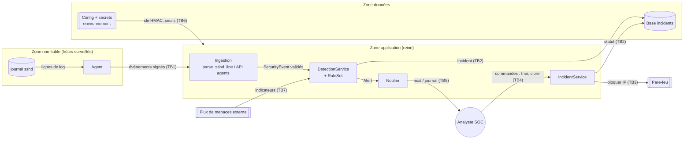

# Modèle de menaces — Queen Bee

> J1 · A1 · méthode STRIDE. Périmètre : agents → reine (ingestion, détection, incidents) → analystes SOC.
> Propriétés **DICP** : **D**isponibilité, **I**ntégrité, **C**onfidentialité, **P**reuve (traçabilité).

## 1. Actifs

| Actif | Pourquoi il compte | D | I | C | P |
|---|---|:-:|:-:|:-:|:-:|
| Clé HMAC des agents | qui la possède peut injecter de faux événements ou masquer une vraie attaque | | | ● | |
| Flux d'événements de sécurité | matière première de la détection : altéré ou perdu, une attaque passe inaperçue | ● | ● | | |
| Règles de détection et seuils | un attaquant qui les modifie (seuil à 10 000, règle supprimée) devient invisible | | ● | | |
| Base des incidents | preuve de ce qui s'est passé et pilotage de la réponse | ● | ● | ● | ● |
| Statut des incidents (workflow) | clore un incident sans triage = arrêter la réponse à une attaque en cours | | ● | | ● |
| Canal d'alerte vers le SOC | si on le noie ou le coupe, les analystes ne voient plus rien | ● | ● | | |
| Liste de blocage du pare-feu | bloquer la mauvaise IP = déni de service sur un service légitime | ● | ● | | |
| Journaux d'audit | permettent de prouver qui a fait quoi | | ● | | ● |

## 2. Acteurs

| Acteur | Légitime ? | Ce qu'il peut faire |
|---|---|---|
| Agent (« abeille ») | oui | envoie des événements signés avec la clé HMAC |
| Analyste SOC | oui | lit, trie, confine, clôt les incidents |
| Lecteur (`viewer`) | oui, droits restreints | consulte, ne modifie rien |
| Administrateur | oui | déploie, configure les règles et les secrets |
| Attaquant externe | non | écrit dans les journaux (tentatives de connexion), envoie de faux messages, sature l'API |
| **Agent compromis** | *a l'air* légitime | possède une vraie clé : messages bien signés mais contenu piégé, flood d'événements |
| Initié malveillant (lecteur) | a un compte | tente de clore un incident ou d'effacer une trace |

## 3. Diagramme de flux de données (DFD) et frontières de confiance



| Frontière | Entre | Pourquoi c'est une frontière |
|---|---|---|
| **TB1** | agents / réseau → API d'ingestion | les données viennent de machines qu'on ne contrôle pas, et le contenu des logs est écrit par l'attaquant (nom d'utilisateur, IP) |
| **TB2** | application → base des incidents | changement de technologie (SQL) : une donnée mal passée devient du code |
| **TB3** | application → pare-feu | une action à fort impact sur la production ; une commande mal formée peut tout débloquer |
| **TB4** | analyste → application | des humains avec des rôles différents ; il faut vérifier les droits à chaque action |
| **TB5** | application → canal d'alerte | sortie vers un système tiers (mail) qui peut être saturé ou recevoir des données sensibles |
| **TB6** | environnement → configuration | les secrets et seuils viennent de l'extérieur du code |
| **TB7** (ajout J2) | flux de menaces externe → application | un fournisseur tiers, avec son propre vocabulaire et ses propres erreurs ; ses données ne doivent pas entrer telles quelles dans le domaine |

## 4. STRIDE par flux traversant une frontière

| Flux | S · usurpation | T · altération | R · répudiation | I · fuite | D · déni de service | E · élévation | Exigences |
|---|---|---|---|---|---|---|---|
| Agent → Ingestion (TB1) | faux agent sans la clé | message modifié en route ; champ ajouté (`is_admin`) ; nom d'utilisateur piégé (`'; DROP`) | — | — | flood, ligne géante, regex catastrophique (ReDoS) | — | EX-01, EX-02, EX-03 |
| Détection → Base (TB2) | — | injection SQL via l'IP ou le nom | effacement d'un incident | lecture de la base par injection | — | — | EX-04 |
| Analyste → Incidents (TB4) | session volée | clore sans triage | « ce n'est pas moi qui ai clos » | — | — | lecteur qui modifie un statut | EX-06, EX-07 |
| Application → Pare-feu (TB3) | — | IP piégée `10.0.0.1; iptables -F` | blocage non tracé | — | blocage d'une IP légitime | injection de commande | J2 (`test_command_undo`) |
| Détection → Alerte (TB5) | — | — | alerte non tracée | secret ou donnée sensible dans le mail | flood d'alertes qui noie le SOC | — | EX-07, J2 (`RateLimitedNotifier`) |
| Config → Application (TB6) | — | règle inconnue ou seuil `True` injecté par la config | — | clé affichée dans un `print` ou une trace | démarrage avec une clé vide | — | EX-05, EX-08 |
| Flux de menaces → Détection (TB7, ajout J2) | faux fournisseur | indicateur qui n'est pas une IP (`evil.com`), niveau de risque inventé | — | — | — | — | EX-09 |
| Alerte → abonnés (TB5, ajout J2) | — | — | — | — | un abonné en panne bloque la diffusion aux autres | — | Observer `AlertBroadcaster` (`test_abuse_broken_subscriber_does_not_block_others`) |

Menaces écartées comme peu crédibles pour ce périmètre : l'usurpation de la base (processus local, même hôte) et la répudiation côté agent (un agent compromis est traité par la révocation de sa clé, hors code).

## 5. Exigences de sécurité (testables)

```
EX-01  Tout message d'agent DOIT porter une signature HMAC-SHA256 valide, vérifiée en temps constant ;
       un message signé avec une autre clé DOIT être rejeté.
       Menace : S sur TB1 · Propriété : Intégrité (authenticité)
       Preuve : tests/test_adapters.py::test_abuse_forged_signature_rejected

EX-02  Toute ligne de journal piégée DOIT être rejetée, et 1 000 lignes piégées DOIVENT être
       traitées en moins de 1 s ; aucune ligne de plus de 512 caractères n'est analysée.
       Menace : D sur TB1 · Propriété : Disponibilité
       Preuve : tests/test_adapters.py::test_parser_is_fast_on_adversarial_input
                tests/test_j1_group.py::test_abuse_parser_rejects

EX-03  Un SecurityEvent DOIT être refusé à la construction si l'IP n'est pas une adresse valide,
       si le nom ne respecte pas [A-Za-z0-9._-]{1,32}, si l'action est hors allowlist
       ou si l'horodatage n'a pas de fuseau ; une fois construit, il NE DOIT PAS être modifiable.
       Menace : T sur TB1 · Propriété : Intégrité
       Preuve : tests/test_domain.py::test_invalid_event_cannot_exist
                tests/test_domain.py::test_event_is_immutable

EX-04  Toute requête SQL DOIT être paramétrée : une charge `x'); DROP TABLE incident;--`
       DOIT être stockée telle quelle comme donnée, la table restant intacte.
       Menace : T et I sur TB2 · Propriété : Intégrité, Confidentialité
       Preuve : tests/test_j1_group.py::test_sqlite_stores_injection_payload_as_data
                tests/test_services.py::test_sqlite_repo_resists_injection

EX-05  La clé HMAC NE DOIT apparaître ni dans str(), ni dans repr() des objets de configuration,
       ni dans les messages d'erreur ; l'application DOIT refuser de démarrer si la clé
       est absente ou fait moins de 32 octets.
       Menace : I sur TB6 · Propriété : Confidentialité
       Preuve : tests/test_j1_group.py::test_secret_never_in_str_or_repr
                tests/test_adapters.py::test_missing_secret_refuses_to_start

EX-06  Un utilisateur sans le rôle « analyst » NE DOIT PAS pouvoir changer le statut
       d'un incident ; le statut DOIT rester inchangé après la tentative.
       Menace : E sur TB4 · Propriété : Intégrité
       Preuve : tests/test_services.py::test_abuse_viewer_cannot_close_incident

EX-07  Un incident NE DOIT PAS pouvoir être clos sans être passé par le triage, et chaque
       alerte notifiée DOIT être écrite dans le journal d'audit « queenbee.audit ».
       Menace : R sur TB4 / TB5 · Propriété : Preuve
       Preuve : tests/test_domain.py::test_state_forbids_skipping_triage
                tests/test_services.py::test_audit_decorator_logs

EX-08  Une règle de détection DOIT être créée uniquement à partir d'un nom présent dans le
       registre (jamais getattr ni importlib), avec un seuil entier compris entre 1 et 10 000
       (True refusé).
       Menace : T et E sur TB6 · Propriété : Intégrité
       Preuve : tests/test_domain.py::test_factory_rejects_unknown_rule
                tests/test_j1_group.py::test_abuse_unknown_rule_name_rejected
                tests/test_j1_group.py::test_abuse_bad_threshold_rejected

EX-09  (ajout J2) Toute entrée du flux de menaces DOIT être traduite par la couche
       anti-corruption en un indicateur dont l'IP est valide et le score compris entre 0 et 100 ;
       une entrée sans IP valide ou avec un niveau de risque inconnu DOIT être rejetée.
       Menace : T sur TB7 · Propriété : Intégrité
       Preuve : tests/test_adapters.py::test_anti_corruption_layer_translates_and_rejects
                tests/test_j2_group.py::test_abuse_threat_feed_rejects
```

### Suivi

| Exigence | STRIDE | Statut fin J1 | Statut fin J2 |
|---|---|---|---|
| EX-01 | S | test écrit, code à faire | ✅ vert |
| EX-02 | D | ✅ en partie | ✅ vert (performance comprise) |
| EX-03 | T | ✅ vert | ✅ vert |
| EX-04 | T, I | ✅ en partie | ✅ vert |
| EX-05 | I | ✅ en partie | ✅ vert |
| EX-06 | E | test écrit, code à faire | ✅ vert |
| EX-07 | R | ✅ machine à états | ✅ vert (audit compris) |
| EX-08 | T, E | ✅ vert | ✅ vert |
| EX-09 | T | — | ✅ vert |

## 6. Revue de sécurité de la variante de laboratoire (ajout J3)

La variante `labs/vulnerable_queenbee.py` contenait sept failles. Chacune a suivi la même démarche :
un test qui **prouve** la faille, une correction **dans la couche où elle est née**, puis le même
test **inversé** en test de non-régression, et un ADR court.

| # | Faille | Couche | STRIDE | DICP | Correction | Test de non-régression | ADR |
|---|---|---|---|---|---|---|---|
| 1 | Secret en dur, partagé par tous les services | configuration | S, I | C | une clé par service, lue dans l'environnement, sans valeur par défaut | `test_faille1_corrigee_*` | 0002 |
| 2 | Regex à retour arrière exponentiel (ReDoS) | adaptateur | D | D | longueur bornée avant la regex, motif sans répétition imbriquée | `test_faille2_corrigee_redos_cost_stays_linear` | 0003 |
| 3 | Désérialisation `pickle` (exécution de code) | adaptateur | T, E | I | `json.loads`, taille bornée, schéma strict | `test_faille3_corrigee_*` | 0004 |
| 4 | Requête SQL construite par f-string | persistance | T, I | I, C | requête paramétrée | `test_faille4_corrigee_sql_injection_returns_nothing` | 0005 |
| 5 | Aucune autorisation dans le service | application | E, R | I, P | rôle analyste exigé en première étape du cas d'usage, refus audité | `test_faille5_corrigee_viewer_cannot_close_an_incident` | 0006 |
| 6 | Services qui ne s'authentifient pas | infrastructure | S, T | I | authentification mutuelle (requête et réponse signées) ; mTLS en production | `test_faille6_corrigee_*` | 0007 |
| 7 | Comparaison de jeton non constante | sécurité | I, S | C | `hmac.compare_digest` | `test_faille7_corrigee_token_is_compared_in_constant_time` | 0008 |

Vérification après correction : `python -m pytest -m lab` → 14 tests verts ; `bandit -r labs` → aucune
alerte (deux alertes de niveau moyen avant correction : `pickle` et SQL par f-string).

**Secret résiduel dans l'historique.** La clé `qb-admin-2026` de la faille 1 reste visible dans le
premier commit : un historique Git ne s'efface pas réellement. Cette clé de laboratoire n'a jamais
protégé aucun système ; elle est considérée comme révoquée et ne doit être réutilisée nulle part.
